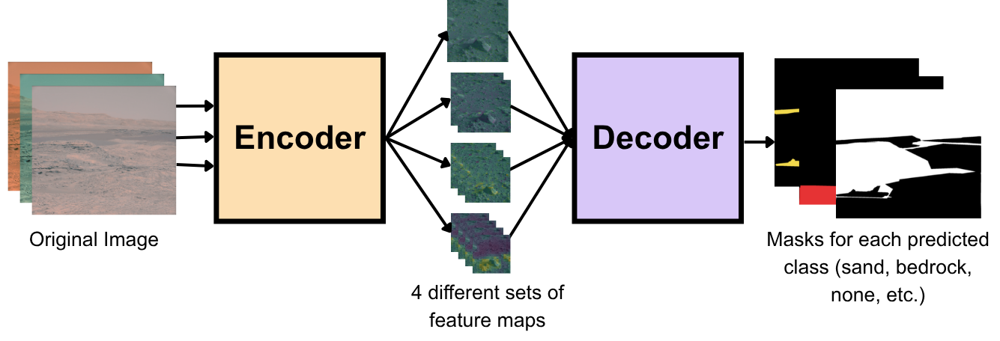
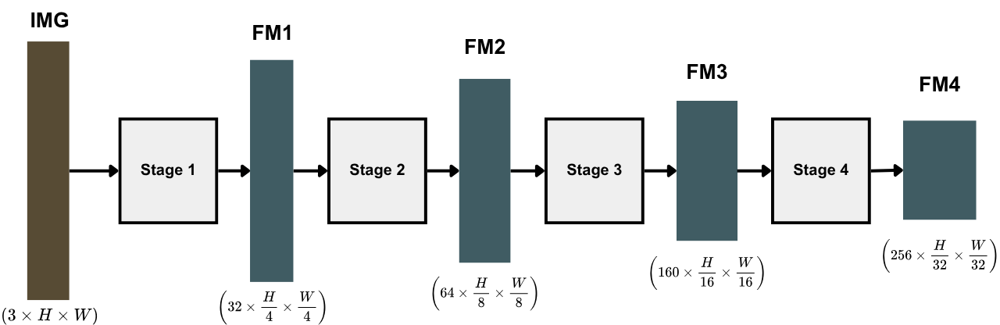
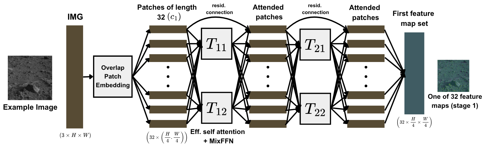
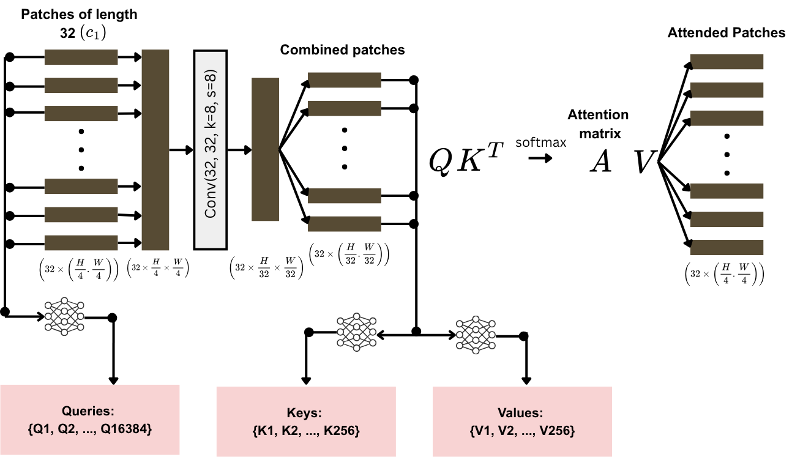
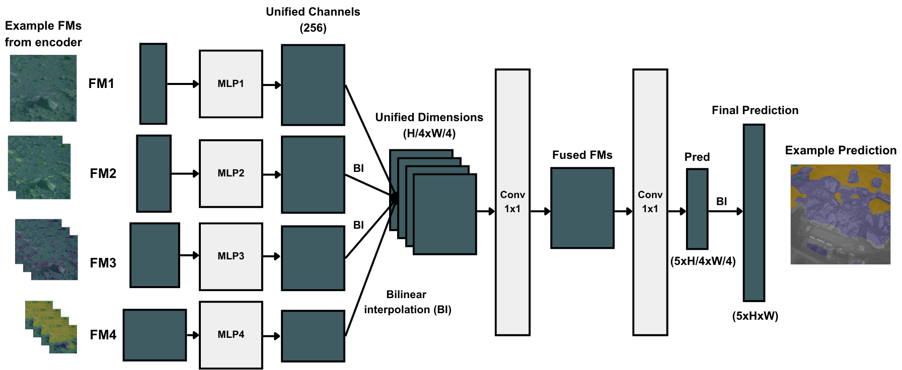

# Segformer
Handled by Noah Lee

Will be trying to implement and fine tune a pretrained segformer-b0 model:
https://huggingface.co/nvidia/segformer-b0-finetuned-ade-512-512 

Segformer repo for reference:
https://github.com/NVlabs/SegFormer/

## Segformer Model

### model.py

Segformer is a transformer encoder-decoder model defined as `SegFormer` in model.py. The encoder uses patch embeddings, efficient self attention and feed forward networks to generate 4 sets of hierarchical feature maps. The feature maps represents patterns extracted from the image of varying coarseness. The lightweight decoder takes these feature maps and matches the channel and map dimensions with MLPs, fuses them together and generates prediction masks.

`build_segformer` is used as a function to initialize the model with the encoder-decoder settings consistent with the b0 model from the Segformer repository: https://github.com/NVlabs/SegFormer/

### encoder.py

The encoder is consists of 4 stages which results in progressively smaller feature maps (FM). With our current implementation with the b0 model, the first stage creates 32 feature maps of size $H/4 \times W/4$. We get these dimensions / larger channels from the patch embedding layer (which uses convolutional layers). The first feature map set (denoted FM1), contains the most local patterns of the image. The FMs get smaller until the final forth stage, where with our b0 model, we have 256 feature maps of size $H/32 \times W/32$. This class is defined in encoder.py as `MixVisionTransformer`.

A specific stage is made up of a patch embedding step, defined in `OverlapPatchEmbed`, and a transformer block step, defined in `Block`. There are residual connections between the blocks to help with training. `OverlapPatchEmbed` is what is responsible for shrinking FM dimensions and increasing channel size. The patches for Segformer overlap, unlike in other models like ViT, to preserve local continuity between the patches. After being processed by `OverlapPatchEmbed`, we can consider the a 'hole' at each position of the FM and treat that as a patch of the image to be attended in `Block`. The high level layout is displayed below:

#### OverlapPatch Embed

Defined in `OverlapPatchEmbed`, this applies a 2D convolution on the image/previous layer of FM to reduce dimensionality and increase channel count. We then reorder the tensor to be in the `hole`/patch format we want for the next step (e.g. a ($32\times128\times128$) tensor becomes ($16384\times32$) so $16384$ patches of length $32$). We then apply a LayerNorm and return the patches for `Block` to process. 

#### Block: Overview

Defined in `Block`, the transformer block is the most confusing part of the model but also what makes it so powerful. It consists of a self-attention block which allows patches to attend to eachother (thereby increasing the effective receptive field of the model), and then applies the mix feed forward network block, which uses MLPs and convolutional layers to add additional compute to the model and eliminate the need for positional encoding.

#### Block: Efficient Self Attention

Implemented in `EffAttention`, efficient self attention differs from a standard attention layer in other transformer models with its use of a convolutional layer to combine patches in order to computer a smaller number of keys and values when computing the attention weights and the final attended patches. 

The attention layer begins with the 16384 vectors ($H/4 \times W/4$ in stage 1, this gets smaller in later stages) of length 32 ($C_1$, this gets larger in later stages). The vectors are then split by its channels in sizes of 32 to be processed in different attention heads - so in stage 1, there is one head, in stage 2 (where the vectors are of length 64, there are 2 attention heads, etc.) - so all vectors processed after this point will be of length 32 regardless of how large the channels are. 

From these vectors, we use a neural network from 32 -> 32 to generate 16384 Queries (Q) where each $Q_i$ is a vector of length 32 that represents what that specific patch is searching for in generating a similarity score. Next, to create the keys and values, we reorder the vectors into the feature map form of $32\times128\times128$ and apply a convolutional layert to reduce the dimensions down to $1/8$th the original size. Then when reordering from feature map form to vector form, we have 256 merged patches. From here, we can apply another neural network to generate 256 key values (K) where each $K_i$ is a vector of length 32 that represents what the patch is giving out when generating the similarity score, and 256 value vectors (V) where each $V_i$ represents the information that the patch is giving out to others. The smaller amount of Ks and Vs makes Segformer's encoder more efficient than standard transformer encoders.

#### Block: Mix Feed Forward Network (Mix-FFN)

* x_out = x + fc2( GELU( DWConv( fc1( LN(x) ) ) ) )
* (16384, 32) -> fc1 -> (16384, 128) -> DWConv 3×3 -> (16384, 128) -> GELU -> fc2 -> (16384, 32)

Implemented in `MixFFN`, the layer takes in the attended patches, expands it to a wider feature space in FC1, reshapes the patches to FM form to use a depth-wise convolution (`DWConv`) to allow for local context and share position information, reorders to patch form, applies GELU for non-linearity and then uses FC2 to bring the patches back to the original dimension.

### decoder.py

The decoder is implemented in decoder.py as `MLPDecoder`. The decoder takes in a set of 4 features and does the following operations:
1. Unify channel dims through feeding each FM into an MLP 
2. Upsamples the H, W dimensions to match $H/4\times W/4$ though billinear interpolation and concatenates the FMs together
3. Fuses the FMs together using a $1\times 1$ convolution (4 -> 1).
4. Generates a final prediction with a $1\times 1$ convolution ($C \to 5$)

## Training/Testing

### loading a pretrained model

In order to save time in training the model, we decided to use a pretrained model that the Segformer authors published at https://huggingface.co/nvidia/segformer-b0-finetuned-ade-512-512 that is trained on ImageNet and finetuned on ADE20K dataset. The pretrained file holds named tenstors. The b0 model implemented here has the same layers and shapes as the HuggingFace pretrained model - just with different names, so the utils/ script `convert_hf_weights.py` renames them. 

The PyTorch checkpoint `state_dict` is a dict from paramater name to tensor: e.g. "encoder.block1.0.attn.q.weight" -> tensor (32, 32). The model by default uses names for the dict using the names from the code: eg. self.encoder -> self.block1[0] -> self.attn -> self.q gives encoder.block1.0.attn.q.weight. `load_state_dict` matches by name - but it doesn't currently match the huggingface names.

#### Downloading the model

The model was downloaded and placed into `pretrained/segformer_b0_ade.bin`. The architecture is the same as ours, just with a different end to the decoder due to the difference in output classes. 

#### convert_hf_weights.py
For each HF key:
* Rename the key to match our naming
* Drop decode head classifier
* Merge K and V (since our implementation computes them together in one NN)
* save result in `pretrained/segformer_b0_ade.pth`

Only run once after downloading pretrained model.

### train.py

### test.py

### visualization.py

### erf.py

Receptive field:
The receptive field is the set of input pixels that can affect it at all. For a plain CNN it grows with each conv and stride. For SegFormer it is already the whole image at stage 1, because every stage uses self-attention, which lets each position look at every other position.

Effective Receptive Field: Being able to see a pixel doesn't mean the network uses it. The ERF measures how much each input pixel actually affects that feature. The measure is the gradient: if nudging input pixel (x, y) changes the feature a lot, that pixel matters. In practice the ERF is usually concentrated near the center and fades out,

Get_input_grad: 
* Forward pass
* Take center pixel of the feature map 
* Calculate gradient of the input pixels - how much did input pixels affect this pixel in feature map
* Store and normalize

